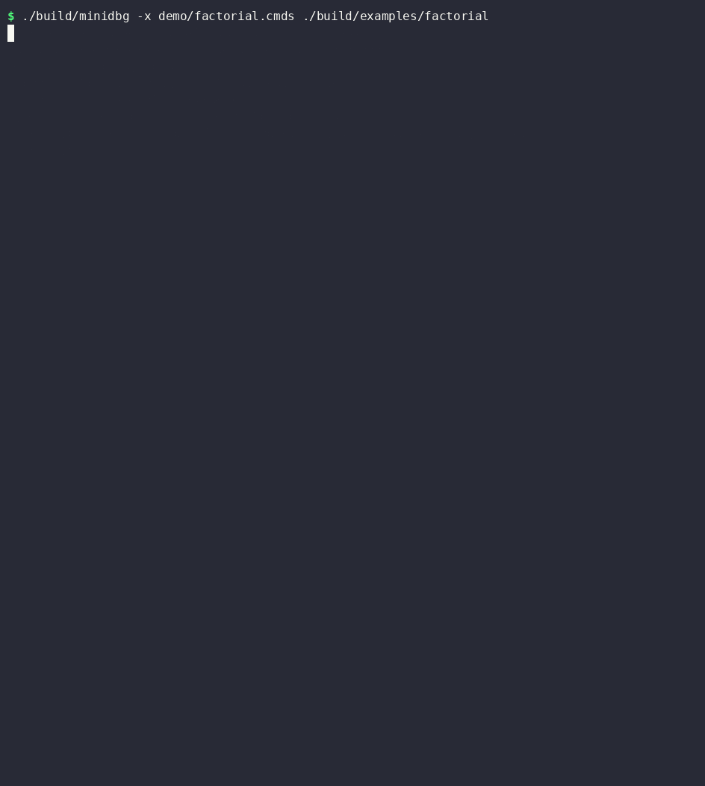

<!-- DEMO-START: replaced with the real recording in the demo commit -->


**[▶ Watch the demo on asciinema](ASCIINEMA_URL)**
<!-- DEMO-END -->

# minidbg

A small command-line debugger for x86-64 Linux programs, written from scratch in C++17 on top of `ptrace`. It parses ELF files by hand (no libelf, no DWARF library, no disassembler library) and implements the core of what gdb does at the machine level: breakpoints, single-stepping, registers, memory, symbols and backtraces.

```
$ ./build/minidbg ./build/examples/factorial
(minidbg) break factorial
(minidbg) continue
(minidbg) bt
```

**What it can do**

| | |
|---|---|
| Launch | `fork` + `PTRACE_TRACEME` + `exec`, ASLR switched off so addresses repeat between runs |
| Load address | reads `/proc/<pid>/maps`, so PIE executables work |
| Symbols | parses `.symtab`/`.strtab` itself; `symbols` lists functions with address and size |
| Breakpoints | `int3` patching by address or function name; steps over them correctly |
| Control | `continue`, `stepi`, exit code / killed-by-signal reporting |
| State | `regs`, `set <reg> <value>`, `x <addr> <count>`, `write <addr> <value>` |
| Location | every stop prints `rip` and `function+offset` |
| Backtrace | `bt` walks the frame-pointer chain (also correct at function entry and at `ret`) |
| Signals | SIGSEGV and friends are reported with the faulting `rip` and function |

## Build and run

Requirements: Ubuntu (or WSL2, not WSL1), `g++` with C++17, `cmake`, `make`. Optional: `nasm` for the assembly example (`sudo apt install nasm`).

```
cmake -S . -B build
cmake --build build
./build/minidbg ./build/examples/factorial
```

The example programs are built into `build/examples/` with `-g -O0 -fno-omit-frame-pointer`:

| Program | Source | Use it to try |
|---|---|---|
| `loop` | [examples/loop.c](examples/loop.c) | breakpoints hit repeatedly, stepping |
| `factorial` | [examples/factorial.c](examples/factorial.c) | recursion, `bt` |
| `segfault` | [examples/segfault.c](examples/segfault.c) | signal reporting |
| `asm_demo` | [examples/asm_demo.asm](examples/asm_demo.asm) | NASM + gcc output, like a compiler would produce |

Inside Docker, `ptrace` needs `--cap-add=SYS_PTRACE` (and a seccomp profile that allows `personality`).

## Commands

| Command | What it does |
|---|---|
| `break <address\|function>` (`b`) | Set a breakpoint. Addresses are runtime addresses, e.g. `0x555555555149`; a name is looked up in the symbol table. |
| `delete <n>` | Remove breakpoint number n |
| `info breakpoints` | List breakpoints with their function+offset |
| `continue` (`c`) | Run until a breakpoint, signal or exit |
| `stepi` (`si`) | Execute exactly one instruction |
| `regs` | Print all registers |
| `set <reg> <value>` | Change a register (`set rdi 3`, `set rax 0x10`, `set r8 -1`) |
| `x <address> [count]` | Dump `count` 8-byte words (hex), two per line |
| `write <address> <value>` | Write an 8-byte value to memory |
| `symbols` | List function symbols with runtime address and size |
| `bt` | Backtrace |
| `help`, `quit` (`q`) | |

Numbers can be decimal or `0x` hex.

## A full session

Everything below is real output from `./build/minidbg ./build/examples/factorial` (addresses depend on your environment, so yours will differ in the stack values).

```
$ ./build/minidbg ./build/examples/factorial
Launched ./build/examples/factorial (pid 1985250).
Position-independent executable loaded at 0x555555554000.
Read 9 function symbols.
Stopped before the program's first instruction:
  rip = 0x7ffff7fe4540 <unknown>
Type 'continue' to run it, 'help' for commands.
(minidbg) break factorial
Breakpoint 1 at 0x555555555149 <factorial+0>
(minidbg) continue
Breakpoint 1 hit.
  rip = 0x555555555149 <factorial+0>
(minidbg) regs
rax       0x0000555555555183  93824992235907
rbx       0x00007fffffffdc98  140737488346264
rcx       0x0000555555557dc0  93824992247232
rdx       0x00007fffffffdca8  140737488346280
rsi       0x00007fffffffdc98  140737488346264
rdi       0x0000000000000005  5
rbp       0x00007fffffffdb70  140737488345968
rsp       0x00007fffffffdb58  140737488345944
r8        0x0000000000000000  0
r9        0x00007ffff7fca380  140737353917312
r10       0x00007fffffffd890  140737488345232
r11       0x0000000000000203  515
r12       0x0000000000000001  1
r13       0x0000000000000000  0
r14       0x0000555555557dc0  93824992247232
r15       0x00007ffff7ffd000  140737354125312
rip       0x0000555555555149  93824992235849
eflags    0x0000000000000206  518
cs        0x0000000000000033  51
ss        0x000000000000002b  43
ds        0x0000000000000000  0
es        0x0000000000000000  0
fs        0x0000000000000000  0
gs        0x0000000000000000  0
fs_base   0x00007ffff7fa0740  140737353746240
gs_base   0x0000000000000000  0
orig_rax  0xffffffffffffffff  -1
(minidbg) set rdi 3
rdi = 0x3
(minidbg) stepi
  rip = 0x55555555514d <factorial+4>
(minidbg) stepi
  rip = 0x55555555514e <factorial+5>
(minidbg) stepi
  rip = 0x555555555151 <factorial+8>
(minidbg) stepi
  rip = 0x555555555152 <factorial+9>
(minidbg) stepi
  rip = 0x555555555156 <factorial+13>
(minidbg) stepi
  rip = 0x555555555159 <factorial+16>
(minidbg) x 0x7fffffffdb3c 1
0x7fffffffdb3c:  0x0000000000000003
(minidbg) x 0x7fffffffdb50 2
0x7fffffffdb50:  0x00007fffffffdb70  0x0000555555555199
(minidbg) continue
Breakpoint 1 hit.
  rip = 0x555555555149 <factorial+0>
(minidbg) bt
#0  0x0000555555555149 <factorial+0>
#1  0x0000555555555179 <factorial+48>
#2  0x0000555555555199 <main+22>
#3  0x00007ffff7c2a1ca <unknown>
(minidbg) delete 1
Deleted breakpoint 1.
(minidbg) continue
factorial(5) = 6
Process 1985250 exited with code 0.
```

What happened, step by step:

1. `break factorial` looked the name up in `.symtab` (file address `0x1149`) and added the load address `0x555555554000`.
2. `continue` ran until the `int3`; `rip` was moved back onto the function's first instruction. `regs` shows `rdi = 5`: the first argument of `factorial(5)` (System V calling convention).
3. **`set rdi 3` changed the program's input.** `main` asked for `factorial(5)`, but the function now sees `n = 3`.
4. Six `stepi`s run the prologue (`endbr64; push rbp; mov rbp,rsp; push rbx; sub rsp,0x18; mov [rbp-0x14],edi`). After `push rbp; mov rbp,rsp`, `rbp` is the old `rsp` minus 8, i.e. `0x7fffffffdb50`, so the variable `n` is at `rbp-0x14 = 0x7fffffffdb3c`.
5. `x 0x7fffffffdb3c 1` reads that **stack variable**: it holds `3`, the value we injected. `x 0x7fffffffdb50 2` shows the frame header: the caller's saved `rbp` and the return address `0x555555555199`, which is `main+22`.
6. `continue` hits the breakpoint again (the recursive call, now `factorial(2)`). `bt` shows `factorial` called from `factorial` called from `main`, even though we stopped on the very first instruction of a function (see "Backtrace" below).
7. After `delete 1` the program finishes and prints **`factorial(5) = 6`** instead of 120: the register change changed the output.

A crash looks like this (`./build/minidbg ./build/examples/segfault`):

```
(minidbg) continue
Program received signal SIGSEGV (Segmentation fault).
  rip = 0x555555555159 <crash+16>
(minidbg) bt
#0  0x0000555555555159 <crash+16>
#1  0x0000555555555183 <main+33>
#2  0x00007ffff7c2a1ca <unknown>
(minidbg) continue
Process 1987569 was killed by SIGSEGV (Segmentation fault).
```

## How it works

### Debugger and program

```
   minidbg (the tracer)                              ./prog (the tracee)
   ────────────────────                              ───────────────────
   fork() ─────────────────────────────────────────► child = copy of minidbg
                                                      ptrace(PTRACE_TRACEME)     "my parent traces me"
                                                      personality(ADDR_NO_RANDOMIZE)
                                                      execv("./prog")            program image replaced
                                                      kernel raises SIGTRAP ───► tracee STOPS before main
   waitpid() returns: "stopped by SIGTRAP" ◄──────────┘
   read /proc/<pid>/maps          → load address
   ptrace(PTRACE_SETOPTIONS, EXITKILL)

   ┌─ repeat for every command ─────────────────────────────────────────────────┐
   │ PTRACE_CONT / PTRACE_SINGLESTEP ───────────────────► tracee runs           │
   │                                                       … int3 executes,      │
   │                                                       or a signal arrives,  │
   │                                                       or it exits …         │
   │ waitpid() returns ◄──────────── kernel stops tracee, tells tracer why       │
   │     exited? killed? stopped by SIGTRAP / SIGSEGV / …?                       │
   │ PTRACE_GETREGS / SETREGS ◄────────────────────────► registers (while stopped)│
   │ PTRACE_PEEKDATA / POKEDATA ◄──────────────────────► memory    (while stopped)│
   └─────────────────────────────────────────────────────────────────────────────┘
```

The tracee only runs between a resume request and the next stop. While it is stopped the debugger can look at and change anything.

### How an `int3` breakpoint works

```
 1. break factorial          A = address of factorial (0x555555555149)
        memory at A:  f3 0f 1e fa …      save the first byte (0xf3)
                      cc 0f 1e fa …      overwrite it with 0xCC (int3)    [PTRACE_POKEDATA]

 2. continue                 the CPU reaches A, executes 0xCC
        → CPU trap → kernel sends SIGTRAP → waitpid() returns in the debugger
        → rip is now A+1 (int3 is one byte long and has already "executed")

 3. hit detected             rip - 1 is the address of a breakpoint
        → set rip = A  [PTRACE_SETREGS]        the user sees the real location

 4. resume (continue / stepi), rip == A and a breakpoint is there:
        a. write the saved byte 0xf3 back to A      the real instruction is in place again
        b. PTRACE_SINGLESTEP                         run just that instruction
        c. write 0xCC to A again                     breakpoint re-armed
        d. PTRACE_CONT (for `continue`)              go on
```

Skipping step 4 makes the program re-execute the same `int3` forever. `x` and `bt` hide the `0xCC` bytes by substituting the saved originals.

### ELF symbols and PIE load addresses

```
 ELF file on disk
 ┌──────────────┐
 │ ELF header   │ e_type (ET_EXEC / ET_DYN=PIE), e_shoff, e_shnum
 ├──────────────┤
 │ …code, data… │
 ├──────────────┤        ┌───────────────── Elf64_Sym ─────────────────┐
 │ .symtab      │───────►│ st_name ─┐  st_value (address)  st_size …    │ one per symbol
 ├──────────────┤        └──────────┼───────────────────────────────────┘
 │ .strtab      │◄──────────────────┘   "…\0factorial\0main\0…"   (st_name = offset into this)
 ├──────────────┤
 │ section hdrs │  Elf64_Shdr[]: type SHT_SYMTAB, and sh_link → which section is .strtab
 └──────────────┘
```

* `minidbg` reads the ELF header, follows `e_shoff` to the section headers, finds the `SHT_SYMTAB` section, and uses its `sh_link` to find the string table. Symbols of type `STT_FUNC` are functions. Assemblers like NASM emit plain `STT_NOTYPE` global labels with size 0, so global no-type symbols in executable sections are accepted too, and a missing size is taken to be the distance to the next symbol.
* **Name → address:** `runtime = load_bias + st_value`. **Address → name:** subtract the bias, binary-search the sorted table, print `name+offset`.
* **PIE:** a position-independent executable is linked as if loaded at address 0, so its `st_value`s are offsets. The kernel loads it somewhere else (`0x555555554000` with ASLR off; random otherwise), and that base is read from `/proc/<pid>/maps`:

```
 555555554000-555555555000 r--p 00000000 08:20 4242  /home/me/minidbg/build/examples/factorial
 ^^^^^^^^^^^^ first mapping of the file = load base
 factorial: st_value 0x1149  →  0x555555554000 + 0x1149 = 0x555555555149
```

  Non-PIE executables (`ET_EXEC`) have fixed addresses, so the bias is 0.

### Backtrace

With `-fno-omit-frame-pointer`, every function begins `push rbp; mov rbp, rsp`, which makes the stack a linked list:

```
 [rbp]     = caller's saved rbp  → next frame
 [rbp + 8] = return address      → "pc" of the caller (printed as function+offset)
```

`bt` follows that chain until it leaves the program (libc's startup code has no frame pointers, so it prints one `<unknown>` frame and stops).

**This only works for programs compiled with `-fno-omit-frame-pointer`.** (At `-O1`+ gcc reuses `rbp` as a normal register and the chain is gone. Real debuggers use `.eh_frame` unwind tables for that case; `minidbg` does not.)

One subtlety is handled: a breakpoint on a function name stops on its first instruction, before `push rbp` has run, so `rbp` still belongs to the *caller*. For frame 0 only, `bt` checks whether `rip` is before `push rbp`, between `push rbp` and `mov rbp, rsp`, or at `ret`, and if so takes the return address from the stack pointer instead.

## Using it with your own compiler's output

Anything that ends up as an x86-64 ELF works. For a compiler that emits NASM:

```
nasm -f elf64 -g prog.asm -o prog.o
gcc prog.o -o prog                # PIE by default on Ubuntu; add -no-pie for a fixed-address build
./build/minidbg ./prog
```

[examples/asm_demo.asm](examples/asm_demo.asm) is written the way such output looks (each source function a `global` label, `push rbp; mov rbp, rsp` frames; no `type`/`size` directives) and is built by CMake when `nasm` is installed:

```
(minidbg) break square
Breakpoint 1 at 0x555555555140 <square+0>
(minidbg) continue
Breakpoint 1 hit.
  rip = 0x555555555140 <square+0>
(minidbg) bt
#0  0x0000555555555140 <square+0>
#1  0x000055555555517c <sum_squares+47>
#2  0x000055555555519a <main+14>
#3  0x00007ffff7c2a1ca <unknown>
```

For `bt` the generated code has to keep the `rbp` frame chain (`push rbp` / `mov rbp, rsp` at function entry).

## Limitations

* **No source-level debugging.** No DWARF: no line numbers, no `step`/`next`, no variable names or types. Breakpoints go on a function's first instruction (no prologue skipping), and local variables are read by raw stack address.
* **Single-threaded programs only.** Threads and `fork`ed children are not traced (no `PTRACE_O_TRACECLONE`/`TRACEFORK`).
* **x86-64 Linux only**, 64-bit ELF, symbols only from the main executable's `.symtab` (stripped binaries have no names; libc and the dynamic loader show up as `<unknown>`).
* **`bt` needs frame pointers** (`-fno-omit-frame-pointer`), see above.
* Only software breakpoints: no watchpoints, conditions or hardware breakpoints. `x` and `write` work on 8-byte words.
* One run per session: there is no `run`/restart; start `minidbg` again.
* Ctrl-C quits the debugger (the program is killed with it) instead of interrupting the program.
* The debugger and the program share the terminal's stdin. When stdout is a pipe, the program's own output is buffered by its libc and shows up only when it exits.

## Project layout

| File | Role |
|---|---|
| [src/main.cpp](src/main.cpp) | argument parsing, `-x` script handling, starts the command loop |
| [src/debugger.cpp](src/debugger.cpp) | the commands, breakpoints, stop reporting, `bt` |
| [src/tracee.cpp](src/tracee.cpp) | every `fork`/`exec`/`waitpid`/`ptrace` call, and `/proc/<pid>/maps` |
| [src/elf.cpp](src/elf.cpp) | ELF64 parser: header, sections, `.symtab`, symbol lookup |
| [src/registers.cpp](src/registers.cpp) | register names ↔ `user_regs_struct` fields |
| [src/util.cpp](src/util.cpp) | `split` and `parse_number` |
